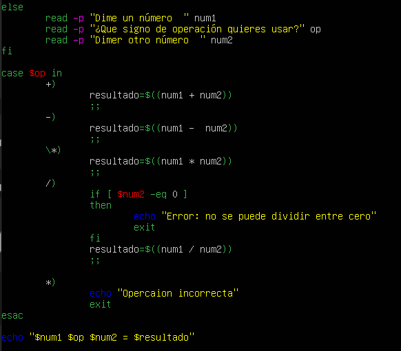
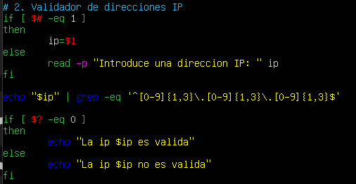
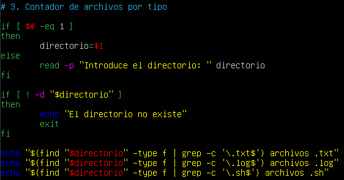
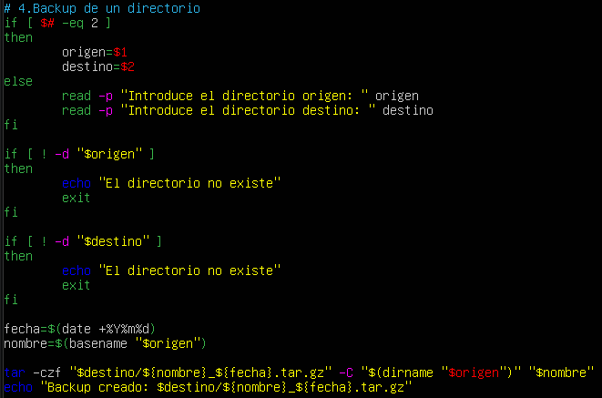
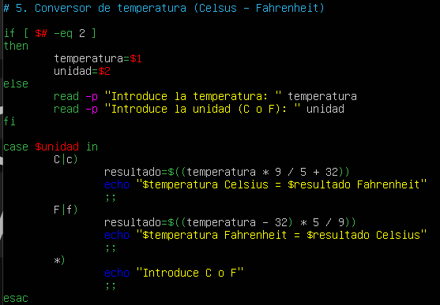
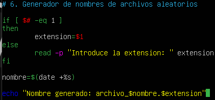
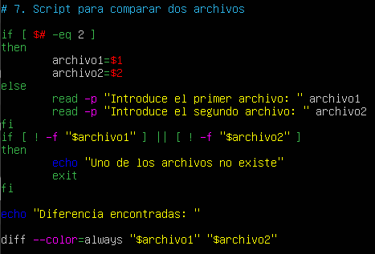
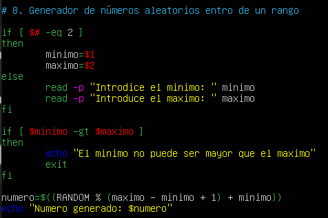

# PR0303: Parámetros en Bash

## 1. Calculadora básica

Crea un script que funcione como una calculadora de operaciones básicas.

Debe recibir como parámetros:

Primer número
Operación (```+```, ```-```, ```*```, ```/```)

Segundo número Si no se pasan parámetros, debe solicitar los valores al usuario.
Debe manejar errores, como división por 0.

Ejemplo de uso:

```python
./calculadora.sh 10 + 5
Salida esperada:
10 + 5 = 15
```




## 2. Validador de direcciones IP

Crea un script que verifique si una dirección IP es válida.

Debe recibir la dirección IP como parámetro.
Si no se pasa, debe pedirla al usuario.
Usa ```grep``` para validar el formato ```X.X.X.X```, donde X es un número que tiene entre 1 y 3 dígitos.
Ejemplo de uso:

```python
./validar_ip.sh 192.168.1.1
Salida esperada:
La IP 192.168.1.1 es válida.
```



## 3. Contador de archivos por tipo

Crea un script que cuente archivos de distintos tipos en un directorio.

Debe recibir el directorio como parámetro (si no se pasara el parámetro lo solicitará por teclado).
Mostrará cuántos archivos hay de cada extensión (```.txt```, ```.sh```,```.log```, etc.).
Usa ```find``` y ```grep``` para procesar los datos.
Ejemplo de uso:

```python
./contador_archivos.sh /home/user
Salida esperada:
10 archivos .txt
5 archivos .log
3 archivos .sh
```



## 4️. Backup de un directorio

Descripción:

Crea un script que realice una copia de seguridad de un directorio.

Debe recibir el directorio origen y el directorio destino como parámetros.
Si no se pasan, debe solicitarlos.
Usa el comando ```tar``` para generar el backup con la fecha actual en el nombre.

```python
./backup.sh /home/user/docs /backups
# Salida esperada:
# Backup creado: /backups/docs_20250328.tar.gz
```



## 5. Conversor de temperatura (Celsius ⇄ Fahrenheit)

Crea un script que convierta una temperatura entre Celsius y Fahrenheit.

Debe recibir la temperatura y la unidad como parámetros (```C``` o ```F```).
Si no se pasan, debe solicitarlos al usuario.

Ejemplo de uso:

```python
./temperatura.sh 100 C
# Salida esperada:
# 100°C = 212°F
```



## 6. Generador de nombres de archivos aleatorios

Crea un script que genere un nombre aleatorio para un archivo.

Debe aceptar una extensión como parámetro.
Si no se pasa, debe preguntar al usuario.
Usa ```/dev/urandom``` o ```date``` para generar nombres únicos.

```python
./nombre_archivo.sh txt
# Salida esperada:
# Nombre generado: archivo_x7a9.txt
```



## 7. Script para comparar dos archivos

Crea un script que compare dos archivos y muestre las diferencias.

Debe recibir los dos archivos como parámetros.
Si no se pasan, debe solicitarlos.
Usa ```diff``` para comparar y mostrar diferencias resaltadas.
Ejemplo de uso:

```python
./comparar.sh file1.txt file2.txt
Salida esperada:
Diferencias encontradas:
- Línea 3: "Hola mundo" → "Hola amigo"
```



## 8. Generador de números aleatorios dentro de un rango

Crea un script que genere un número aleatorio entre un mínimo y un máximo.

Debe recibir los valores mínimo y máximo como parámetros.
Si no se pasan, debe solicitarlos al usuario.
Usa ```$RANDOM``` para generar el número.
Ejemplo de uso:

```python
./random.sh 1 100
Salida esperada:
Número generado: 57
```


