# PR0501: PR0501. Diagnóstico y control de procesos en Linux

## 1. Objetivo

Aplicar en un entorno Linux real los conceptos fundamentales de gestión de procesos: identificación (`PID`, `PPID`, `TTY`), jerarquía padre-hijo, estados del ciclo de vida (`R`, `S`, `T`, `Z`), control de trabajos en primer y segundo plano, prioridades de planificación (`nice` / `renice`), envío de señales (`SIGTERM`, `SIGKILL`) y limpieza de procesos zombi.

## 2. Entorno de trabajo

Debes conectarte a la máquina remota preparada por el profesor. El nombre de usuario de la máquina es `alumno` y no tiene contraseña. La dirección IP te la indicará el profesor.

En el directorio personal `/home/alumno` se encuentra preparado un script `zombi_demo.py` para simular un proceso zombi de forma controlada que necesitarás más adelante en la práctica.

**Importante:** al finalizar cada prueba de carga (con el comando `yes`), debes detener los procesos lanzados para mantener el sistema estable y limpio.

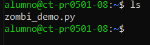

## 3. Tareas a realizar

### Fase 1. Identificación, parentesco y jerarquía de procesos

1. Abre dos terminales conectadas a tu contenedor.
2. En la **Terminal 1**, lanza un proceso durmiente en primer plano con `sleep 300`
3. En la **Terminal 2**, localiza el `PID` y el `PPID` de `sleep 300`.
4. Muestra el árbol jerárquico de procesos.
5. En la entrega, además de las capturas de pantalla, debes indicar:
    - ¿Cuál es el `PID` del proceso `sleep` y cuál es el `PID` de su proceso padre (`PPID`)? ¿A qué proceso corresponde ese padre?

        El PID del proceso sleep es 707(padre) y el hijo es 708.

    - Indica dos procesos del sistema que tengan `?` en la columna `TTY` y explica qué significa.

        El símbolo ? indica que el proceso no está asociado a ninguna terminal de control (ni física tty ni pseudoterminal pts). Son procesos del núcleo (kernel threads) o demonios (daemons) que se ejecutan en segundo plano de forma autónoma desde el arranque del sistema.

    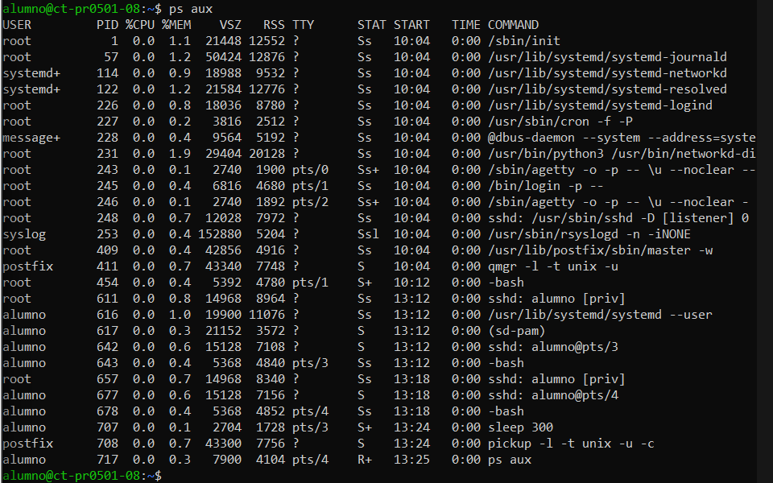

### Fase 2. Primer plano, segundo plano y control de trabajos

1. En la **Terminal 1**, pulsa `Ctrl + Z` para suspender `sleep 300`.
2. En la **Terminal 2** (o en la **Terminal 1** tras suspenderlo), comprueba el estado del trabajo con `jobs -l` y `ps`.

    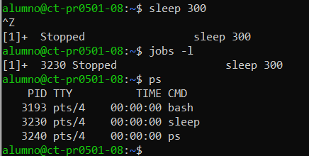

3. Pasa el trabajo suspendido a segundo plano con `bg` y comprueba cómo cambia su estado.
4. Trae el trabajo de vuelta a primer plano con `fg` y ciérralo limpiamente (`Ctrl + C`).

    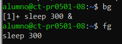

5. Lanza ahora una tarea en segundo plano redirigiendo su salida y errores: `find / -name "*.conf" > /tmp/confs.txt 2>/dev/null &`. Comprueba con `jobs` que aparece en segundo plano.

    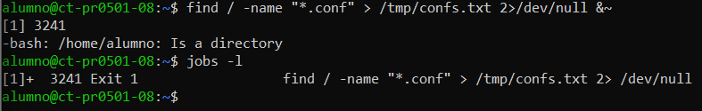

6. Prueba la diferencia entre lanzar un proceso en segundo plano normal (`sleep 120 &`) y lanzarlo protegido frente al cierre de sesión con `nohup` (`nohup sleep 120 > /tmp/sleep_nohup.log 2>&1 &`). Comprueba con `ps -ef` que sigue activo.

    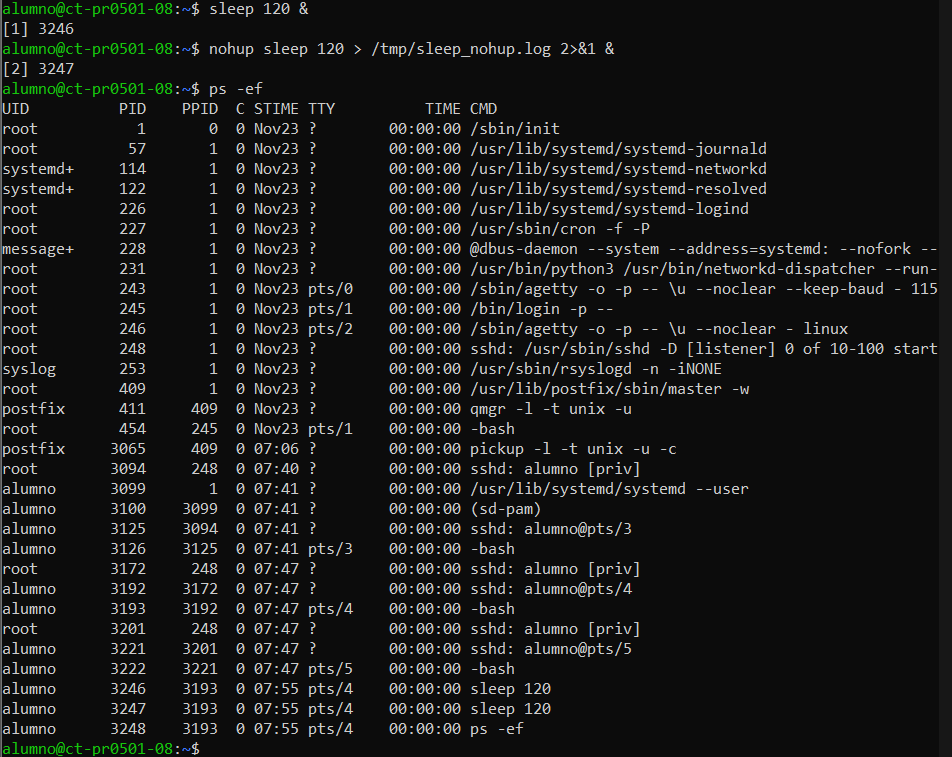

7. Indica en la entrega:
    - ¿Qué estado muestra `STAT` al suspender con `Ctrl + Z` y qué ocurre al ejecutar `bg`?

        Al pulsar Ctrl + Z, se envía la señal SIGTSTP y el estado STAT cambia a T (o Tl), que significa Stopped (proceso detenido/suspendido por una señal de control de trabajos).

        Al ejecutar bg, se envía la señal SIGCONT para reanudar la ejecución del proceso, pero en segundo plano, devolviendo el control del prompt de la terminal al usuario. Su estado STAT pasa de T a S (Interruptible Sleep, en el caso de sleep, ya que está esperando a que pase el tiempo) o R (si estuviera usando CPU).

    - ¿Para qué sirve `nohup` y por qué es habitual redirigir `stdout` y `stderr` al ejecutar en segundo plano?

        nohup (No Hang Up): Sirve para inmunizar un proceso frente a la señal SIGHUP, la cual se envía automáticamente cuando se cierra la terminal o se desconecta la sesión SSH. Gracias a nohup, el proceso sigue ejecutándose aunque el usuario cierre su sesión.

        Redirección de salida y errores (> archivo 2>&1): Si un proceso en segundo plano escribe en la salida estándar (stdout) o de error (stderr), esos mensajes aparecerán por pantalla interrumpiendo lo que el usuario esté escribiendo en la terminal. Además, si la terminal se cierra y el proceso intenta escribir en ella sin haberla redirigido, puede fallar o bloquearse por errores de E/S (de hecho, nohup redirige por defecto a nohup.out si el usuario no especifica otro archivo).

### Fase 3. Monitorización en vivo y prioridades (`top` / `htop`, `nice`, `renice`)

1. Lanza un proceso consumidor de CPU en segundo plano con `yes > /dev/null &`
2. Observa el consumo de CPU y el estado del proceso en `htop` o `top` (identifica su `PID` y su valor `NI`).

    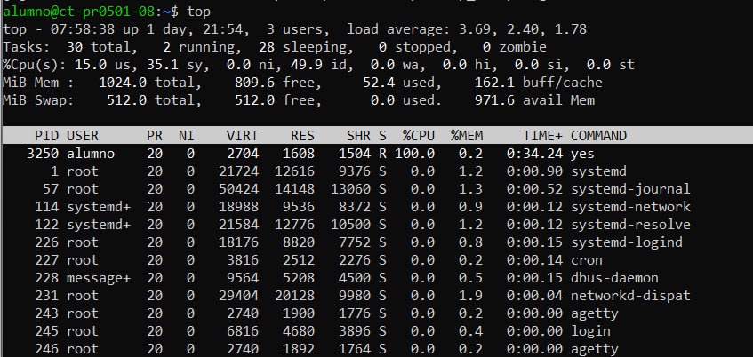

3. Reduce su prioridad de planificación a `15` usando `renice`
4. Comprueba en `top` / `htop` o en `ps -o pid,ppid,ni,stat,cmd -p <PID_de_yes>` que su valor `NI` ha cambiado.

    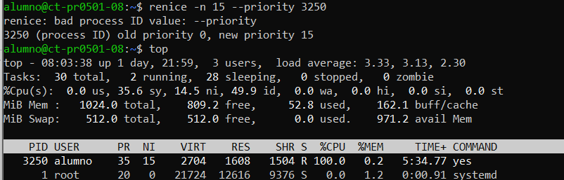

5. Lanza otra instancia de `yes` con prioridad baja desde el inicio mediante `nice` (`nice -n 19 yes > /dev/null &`)
6. Detén ambos procesos `yes` cuando termines la observación.

    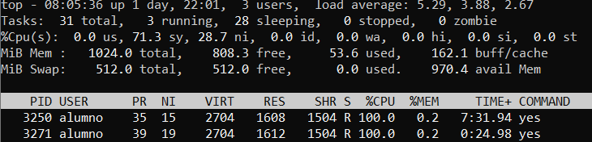
    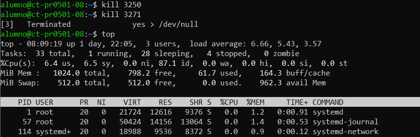

7. Anota en tu entrega:
    - ¿Qué significa el valor *nice* (`NI`) y qué implica que un proceso tenga un valor positivo alto (como `15` o `19`) frente a uno bajo/negativo?

        El valor NI (niceness o "amabilidad") es un parámetro que orienta al planificador del kernel (scheduler) sobre la prioridad de asignación de tiempo de CPU de un proceso. Su rango va de -20 (máxima prioridad) a +19 (mínima prioridad), siendo 0 el valor por defecto.

        Un valor positivo alto (15 o 19) significa que el proceso es "muy amable" con los demás: tiene menor prioridad y cede tiempo de CPU fácilmente a otros procesos que lo necesiten. Por el contrario, un valor bajo o negativo (requiere permisos de root) otorga mayor prioridad, haciendo que el planificador le asigne más ciclos de CPU frente al resto.

    - ¿Qué letra aparece en `STAT` cuando el proceso está listo o ejecutándose en CPU?

        Aparece la letra R (Running o Runnable), que indica que el proceso se está ejecutando activamente en un núcleo de la CPU o está en la cola de listos esperando su turno inmediato de ejecución.

### Fase 4. Detección y limpieza de un proceso zombi (`Z`)

1. Ejecuta el script de prueba en una terminal con `python3 /home/alumno/zombi_demo.py` *(NOTA: el proceso padre permanecerá activo unos 180 segundos).*

    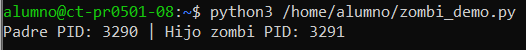

2. En otra terminal, busca los procesos relacionados con `zombi_demo.py` mediante `ps -ef` o `ps aux`.

    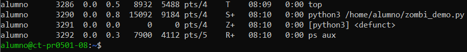

3. Identifica:
    - El `PID` del proceso hijo en estado `Z` (zombi).
    - El `PID` del proceso padre (`python3`) que lo creó (que será el `PPID` del zombi).
4. Intenta finalizar directamente el proceso zombi con `kill -9 <PID_zombi>` y vuelve a comprobar con `ps -ef` si el proceso zombi ha desaparecido.

    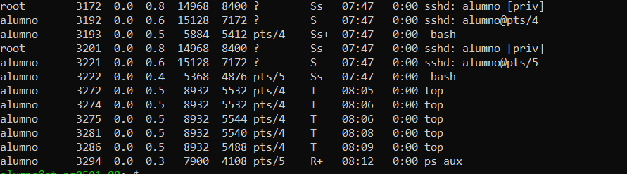

5. Ahora envía una señal de terminación ordenada (`SIGTERM`) al **proceso padre**. Comprueba con `ps -ef` que tanto el padre como el proceso zombi han desaparecido de la tabla de procesos.

    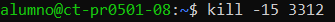
    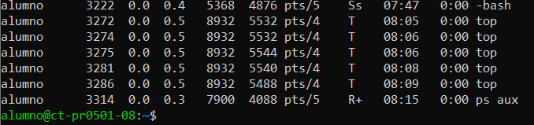

6. En la entrega:
    - Explica por qué `kill -9` sobre el proceso zombi no lo elimina.

        Un proceso en estado zombi (Z) ya ha terminado su ejecución y ha liberado toda su memoria y recursos; únicamente conserva una entrada mínima en la tabla de procesos del kernel para guardar su código de salida (exit status). Como el proceso ya está "muerto", no puede recibir ni procesar ninguna señal, ni siquiera SIGKILL (kill -9)

    - Explica qué ocurre al matar al proceso padre y por qué desaparece entonces el zombi.

        Un proceso zombi permanece en la tabla esperando a que su proceso padre lea su estado de salida mediante la llamada al sistema wait(). Al terminar al proceso padre (con SIGTERM), el proceso zombi queda huérfano y es adoptado automáticamente por el proceso raíz del sistema (init o systemd, PID 1). Este proceso padre universal ejecuta periódicamente la llamada wait() sobre todos sus hijos adoptados, recogiendo el estado de salida del zombi y permitiendo que el kernel elimine definitivamente su entrada de la tabla de procesos.

### Fase 5. Verificación y limpieza final

1. Comprueba con `ps -u $USER -f` los procesos activos de tu usuario.

    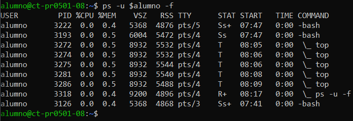

2. Si queda algún proceso residual de prueba (`sleep`, `yes`, `python3`), finalízalo de forma ordenada o forzada si no responde.

3. Limpia los archivos temporales creados en `/tmp` (`/tmp/confs.txt`, `/tmp/sleep_nohup.log`).

    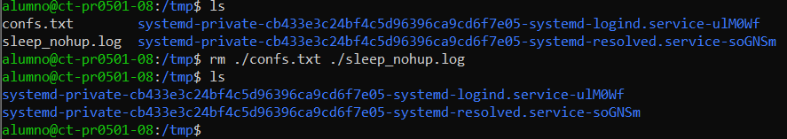

## 4. Entrega

Presenta un documento (Markdown o PDF) que incluya:

1. Los **comandos exactos** empleados en cada fase.
2. **Capturas de pantalla o salidas de terminal** representativas (especialmente de la jerarquía con `pstree`/`ps`, del cambio de prioridad y de la detección/limpieza del proceso zombi).
3. Las **respuestas razonadas** a las preguntas de cada fase.

## Anexo

Si no has asistido a clase y realizas la práctica desde tu propio equipo (máquina virtual, WSL o Linux nativo limpio), sigue estos pasos para dejar el entorno listo:

1. **Instalar herramientas necesarias:** actualiza los repositorios e instala `htop`, `psmisc`, `procps` y `python3`:
2. **Crear el script zombi_demo.py:** crea en el directorio del usuario el archivo que lanza el proceso zombi con el siguiente código:

    ```bash
    cat <<'EOF' > ~/zombi_demo.py
    import os, sys, time

    pid = os.fork()
    if pid > 0:
    print(f"Padre PID={os.getpid()} | Hijo zombi PID={pid}", flush=True)
    time.sleep(180)
    else:
    sys.exit(0)
    EOF
    ```


